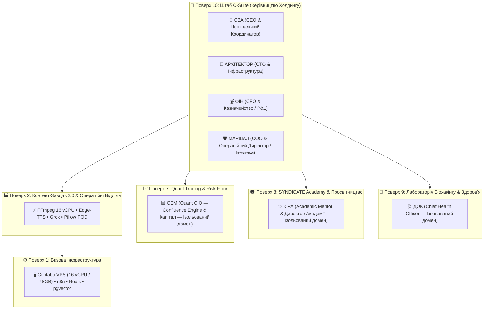

# 🎓 SYNDICATE Academy — Поверх 8: Просвітництво та Академічне Менторство (Кіра)

> **Історичний документ.** Не є джерелом активної ролі, моделі чи grants. Чинні межі: `kira_core/KIRA_ROLE_BOUNDARIES.md`, `config/agents/kira.profile.json` (`prepared_not_enabled`).

## 🏛️ Архітектура Поверхів SYNDICATE (Holding Floor Hierarchy)

Згідно з новою архітектурною моделлю суверенного холдингу **SYNDICATE**, впроваджено принцип **суворої доменної ізоляції та вузької спеціалізації**:

---

## 🛡️ Принцип Суворої Доменної Ізоляції (Strict Specialization)

> [!IMPORTANT]
> **ДОК, КІРА та СЕМ мають абсолютну доменну автономію.**
> На них не накладаються сторонні операційні задачі холдингу. Вони не займаються маркетингом, відправкою листів чи рутиною інших агентів.
> Кожен із них керує власним спеціалізованим поверхом, де проводить глибокі дослідження, аналітику, тренування та видає авторитетні висновки для Лідера Холдингу (Андрія) та C-Suite.

1. **ДОК (Поверх 9):** Фізіологія, нейробіологія, сон, варіабельність серцевого ритму (HRV), готовність нервової системи, персоналізоване харчування (КБЖУ), протоколи навантажень та превентивна медицина.
2. **КІРА (Поверх 8):** Академічне менторство, скорочення когнітивної ентропії, сократівський метод викладання, передача знань від перших принципів (First Principles) у 5 ключових дисциплінах.
3. **СЕМ (Поверх 7):** Торговий поверх, оцінка ринкової ліквідності, Smart Money Concepts (SMC), захист капіталу, розрахунок математичного сподівання та суворий протокол Human-in-the-Loop (HITL).

---

## 🌟 Ментор Кіра (Kira Agent Specification)

- **Агент:** `kira` (`KiraAgent`)
- **Поверх:** 8 (Академія & Просвітництво)
- **Архетип:** Інтелектуальний спаринг-партнер, ерудит, академічний ментор світового класу.
- **Сфера візуалізації в Cockpit:** **Біло-платинова із льодовим сяйвом (Pure Platinum / Glacier Ice Glow)**. Символізує кришталеву ясність мислення, відсутність ментального шуму та академічну чистоту.

---

## 📚 5 Фундаментальних Дисциплін Академії

### 1. 🇬🇧 Англійська мова (English Mastery)
- **Ціль:** Досягнення бездоганної виконавчої присутності (Executive Presence) рівня CEO Кремнієвої долини.
- **Фокус:**
  - Пітчинг суверенних платформ венчурним партнерам (a16z, Sequoia).
  - Захист інженерних рішень та архітектурних компромісів англійською мовою.
  - Усунення русизмів/кальок, впровадження нативних американських ідіом та точних дієслів.
  - Робота з нюансами: тон переговорів, м'яка сила, тверді заперечення.

### 2. 💻 Програмування (Software Engineering & Architecture)
- **Ціль:** Проєктування масштабованих, стійких розподілених систем без переускладнення (Anti-bloat).
- **Фокус:**
  - Глибокий Python: асинхронність (`asyncio.TaskGroup`, Python 3.11+), пам'ять, GIL, генератори.
  - Розподілені системи: CAP-теорема, консенсус, реплікація, idempotency keys, CQRS.
  - Низькорівнева оптимізація та рефакторинг спагеті-коду в чисті функції.
  - Патерни стійкості: Circuit Breaker, Rate Limiting (Token Bucket), Exponential Backoff.

### 3. 🧠 Нейромережі (AI Engineering & Autonomous Agents)
- **Ціль:** Побудова надійних багатоагентних систем, що не ламаються в продакшені.
- **Фокус:**
  - Оркестрація агентів через LangGraph (циклічні графи, збереження стану, точки контролю HITL).
  - Гібридна агентна пам'ять: Epistemic vs Episodic vs Semantic (`pgvector` + GraphRAG).
  - Семантична маршрутизація запитів та захист від Prompt Injection / Jailbreaks.
  - Розгортання локальних відкритих моделей (Ollama, vLLM, DeepSeek, Qwen).

### 4. ⚡ Вайбкодинг (Rapid AI Prototyping & Flow)
- **Ціль:** Перетворення сирої ідеї на робочий production-ready сервіс за 30–60 хвилин.
- **Фокус:**
  - Мистецтво складання односторінкових специфікацій (Spec-Driven Prompting) для Claude та Cursor.
  - Оптимізація файлів правил `.cursorrules` для мінімізації галюцинацій кодогенератора.
  - Агентні цикли налагодження (Agentic Debugging Loops): автоматичне виправлення синтаксису без ручного копіпасту.
  - Швидка збірка MVP: FastAPI + Tailwind + SQLite/Postgres.

### 5. 🏛️ Історія (World History, Strategy & Mental Models)
- **Ціль:** Засвоєння вічних законів влади, організаційного виживання та стратегічної боротьби.
- **Фокус:**
  - Розпад Римської Республіки: поляризація, інституційна ерозія та перехід до принципату.
  - Стратегія непрямих дій (Сунь Цзи, Ліддел Гарт): досягнення цілі без лобового зіткнення.
  - Тетрархія Діоклетіана: децентралізація управління за збереження єдиного суверенітету (урок для мультиагентних холдингів).
  - Історія валютних криз та промислових революцій: девальвація римського денарія, тюльпаноманія та технологічні хвилі.

---

## ⚙️ Методи та Інструменти `KiraAgent` (`src/agents/kira.py`)

| Метод | Опис | Вхідні параметри |
|---|---|---|
| `socratic_dialogue` | Сократівський спаринг: контр-питання, руйнування припущень | `topic`, `statement`, `discipline` |
| `lesson_plan` | Генерація інтенсивного плану навчання з 3 модулями | `discipline`, `goal`, `depth` |
| `code_review` | Менторський аудит коду: архітектурна краса та вайбкодинг | `code`, `language` |
| `language_practice` | Англійський drill для executive-переговорів та пітчингу | `scenario`, `user_input` |
| `history_synthesis` | Синтез історичних прецедентів для сучасних дилем | `query` |
| `vibecoding_session` | Складання надточного брифу для Cursor / Claude | `concept` |
| `micro_quiz` | Експрес-тест із 3 запитань на закріплення знань | `discipline`, `topic` |
| `morning_data` | Когнітивна іскра (слово дня, історична модель, порада) для ранкового брифінгу Єви о 07:00 | - |

---

## 🖥️ Інтерфейс у Cockpit

- **Елевейтор:** Кнопка **`8F КІРА (АКАДЕМІЯ)`** із неоновим крижаним бейджем.
- **Вкладка Агента:** Портрет біло-платинової сфери з орбітальними квантовими кільцями знань.
- **Інтерактивний перемикач 5 дисциплін:** Миттєва зміна програми, виведення модулів та швидких клікабельних тез.
- **Консоль спарингу:** Живе поле введення з підтримкою Enter, швидкими форматами («🥊 Спаринг», «📚 План», «🔍 Рев'ю», «⚡ Тест», «🏛️ Історія») та стилізованим терміналом виводу.
