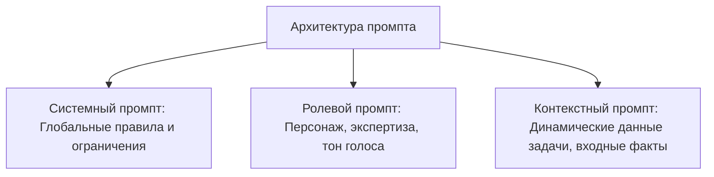
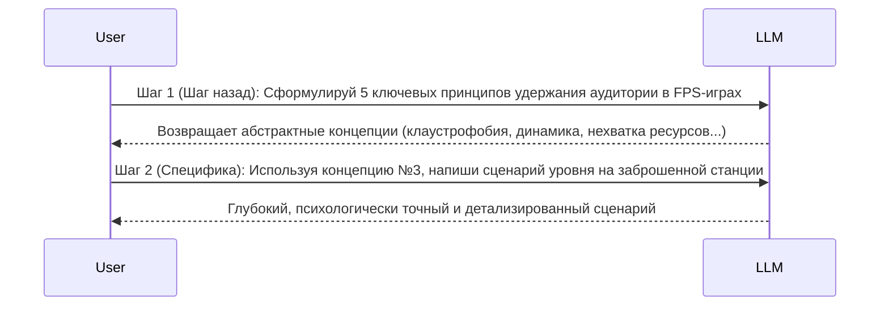
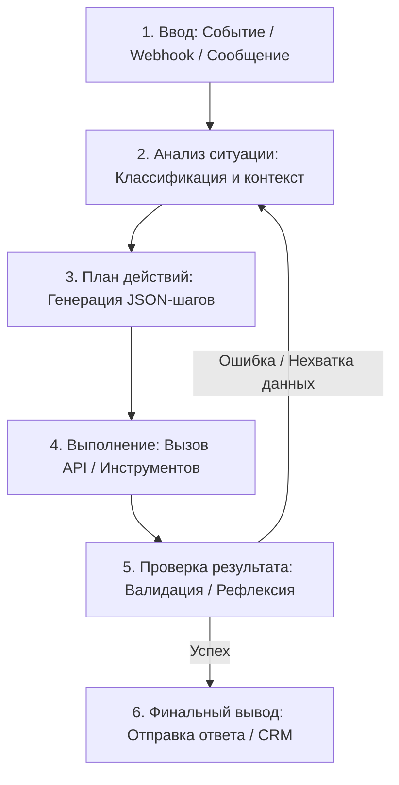

# 🧠 Промпт-инжиниринг и Архитектура Интеллектуальных ИИ-Агентов

> **О чем это руководство:**  
> Промптинг (*prompt engineering*) — это больше, чем техника. Это язык общения с разумом машин. Это мост между человеческим замыслом и цифровым исполнением. Это ключ, открывающий двери к полноценной автоматизации, созданию ИИ-агентов и построению сложных цепочек решений без необходимости писать ни строчки кода.  
> 
> Правильно сформулированный запрос — это алгоритм, стратегия, бизнес-процесс в миниатюре. Это интерфейс между вашим мышлением и возможностями нейросети.

---

## 📑 Содержание

1. [Введение в механику LLM (Диджейский пульт)](#1-введение-в-механику-llm)
2. [Конфигурация параметров вывода LLM](#2-конфигурация-параметров-вывода-llm)
   - Длина вывода (Max Tokens)
   - Управление выборкой: Temperature, Top-K, Top-P
   - Комплексное взаимодействие параметров
   - Ошибка цикла повторения (Repetition Loop)
3. [Фундаментальные методы промптинга](#3-фундаментальные-методы-промптинга)
   - Zero-Shot Prompting
   - One-Shot и Few-Shot Prompting
   - Системные, Контекстные и Ролевые промпты
   - Библиотека Tone of Voice (10 стилей для фриланса и бизнеса)
   - Контекстный промптинг
   - Промптинг с отступлением назад (Step-Back Prompting)
4. [Продвинутые техники рассуждения](#4-продвинутые-техники-рассуждения)
   - Chain-of-Thought (Цепочка мыслей, CoT)
   - Self-Consistency (Самосогласованность и мажоритарное голосование)
   - Tree of Thoughts (Дерево мыслей, ToT)
   - ReAct (Reason + Act / Рассуждение и действие)
   - Automatic Prompt Engineer (APE / Автоматическая разработка промптов)
5. [Промпты для программирования и структурирования данных](#5-промпты-для-программирования-и-структурирования-данных)
   - Написание кода с LLM (Gemini, Claude, Claude Code)
   - JSON и XML форматирование вывода
   - Использование JSON-схем для структурированного ввода и вывода
   - Лучшие практики: глаголы действия, положительные инструкции, переменные
6. [Четыре группы методик промптинжиниринга и их реализация в n8n](#6-четыре-группы-методик-в-n8n)
   - Группа 1: Основы и Контекст (Zero-Shot, Few-Shot, Generated Knowledge, Directional Stimulus)
   - Группа 2: Логика и Рассуждение (CoT, Self-Consistency, Active Prompting, Reflexion)
   - Группа 3: Многошаговые процессы (Prompt Chaining, Tree of Thoughts, PAL)
   - Группа 4: Автоматизация и Инструменты (Multimodal/Graph, RAG, Tool-Use, ReAct, APE)
7. [Гибридные стратегии промптинжиниринга в n8n](#7-гибридные-стратегии-в-n8n)
   - Стратегия 1: Few-Shot + Chain-of-Thought
   - Стратегия 2: RAG + Prompt Chaining
   - Стратегия 3: Active Prompt + ReAct
   - Стратегия 4: Tree of Thoughts + Self-Consistency
   - Стратегия 5: PAL + Reflexion
8. [Интеллектуальные Автономные Агенты на базе n8n](#8-интеллектуальные-автономные-агенты)
   - 5-этапный жизненный цикл агента
   - Базовая архитектура и узлы n8n
   - Пример 1: Telegram-агент-советник
   - Пример 2: Агент-копирайтер
   - Пример 3: Финансовый ассистент с агентной логикой
   - Пример 4: Самообучающийся агент
9. [Пять Промышленных Бизнес-Кейсов Автоматизации](#9-пять-промышленных-бизнес-кейсов)
   - Кейс 1: Клиентская поддержка — фильтрация и автоответы
   - Кейс 2: Генерация постов и омниканального контента
   - Кейс 3: Финансовая аналитика банковских выписок (CSV -> Slides)
   - Кейс 4: Юридический ассистент по договорам (PDF Analysis)
   - Кейс 5: Рекрутер-бот (Скрининг резюме и скоринг)

---

## 1. Введение в механику LLM

Большая языковая модель (LLM) принимает последовательный текст в качестве входных данных (*prompt*), а затем предсказывает, каким должен быть следующий токен на основе огромных обучающих массивов данных.

### Модель как «Диджейский пульт»
LLM можно представить как диджейский пульт с множеством тумблеров (весов):
- **Веса** — это числовые настройки, которые определяют, сколько «вкуса» (информации) передаётся от одного этапа обработки к другому.
- Предсказание следующего токена основано на вероятностном распределении среди всех слов в словаре модели.

```
Входная фраза: "44 президента США зовут Барак..."
                      │
   ┌──────────────────┼──────────────────┬─────────────────┐
   ▼                  ▼                  ▼                 ▼
"Обама" (25%)   "Хуссейн" (5%)    "Обама II" (7%)   "Олегович Чичваркин" (1%)
```

**Промптинжиниринг** — это процесс проектирования высококачественных запросов, которые направляют вероятностное предсказание модели в строго желаемое русло, оптимизируя длину, стиль, контекст и структуру задачи.

---

## 2. Конфигурация параметров вывода LLM

Перед отправкой промпта критически важно настроить гиперпараметры выборки (*sampling parameters*), доступные через API или специализированные интерфейсы (Vertex AI Studio, OpenAI Playground, Make/n8n):

### 2.1. Длина вывода (Max Output Tokens)
- Ограничивает предельное количество генерируемых токенов.
- **Важно:** Уменьшение `max_tokens` **не делает** модель более краткой стилистически; оно просто физически обрезает генерацию при достижении лимита.
- Если для задачи нужен краткий ответ, краткость необходимо закладывать в сам промпт через системные инструкции.
- В методах типа ReAct и Chain-of-Thought ограничение токенов критично, чтобы агент не зацикливался.
- *Правило:* Чем меньше `max_tokens`, тем меньше у модели пространства для скрытых рассуждений. При значении 5–10 токенов модель может ошибиться даже в простом вопросе.

### 2.2. Управление выборкой: Temperature, Top-K, Top-P

| Параметр | Диапазон | Механика работы | Назначение |
| :--- | :--- | :--- | :--- |
| **Temperature ($T$)** | $0.0 - 2.0$ | Контролирует степень случайности (функция Softmax). При $T=0$ (жадное декодирование / greedy decoding) выбирается строго наиболее вероятный токен. | $0.0-0.2$: Точные вычисления, код, классификация, извлечение фактов.<br>$0.7-1.0$: Креатив, копирайтинг, брейншторм. |
| **Top-K** | $1 - 100+$ | Ограничивает пул кандидатов ровно $K$ наиболее вероятными токенами. Top-K=1 эквивалентен жадному декодированию. | Фильтрует «хвост» маловероятных нелепых слов. |
| **Top-P (Nucleus Sampling)** | $0.0 - 1.0$ | Выбирает минимальный набор токенов, чья кумулятивная вероятность достигает значения $P$. | Динамически адаптирует размер пула кандидатов в зависимости от уверенности модели. |

### 2.3. Комплексное взаимодействие параметров
1. **Top-K + Top-P + Temperature:** Сначала токены фильтруются по Top-K и Top-P порогам, а затем к оставшемуся пулу кандидатов применяется Temperature (сглаживание или обострение вероятностей Softmax).
2. **Экстремальные режимы:**
   - Если $T = 0$, параметры Top-K и Top-P фактически игнорируются, так как модель всегда берёт первый токен.
   - Если Top-K = 1, Temperature и Top-P не имеют значения.
   - Если Top-P = 0 (или близко к 0), рассматривается только самый вероятный токен.

> [!TIP] Практические пресеты параметров (проверено на Gemini Pro & GPT-4o):
> - **Фактические задачи и аналитика:** Temperature `0.1 - 0.2`, Top-P `0.90 - 0.95`, Top-K `20 - 30`.
> - **Сбалансированный режим:** Temperature `0.7`, Top-P `0.95`, Top-K `40`.
> - **Креативный брейншторминг:** Temperature `0.9 - 1.0`, Top-P `0.99`, Top-K `40 - 50`.

### 2.4. Ошибка цикла повторения (Repetition Loop)
Распространённый сбой LLM — застревание в бесконечном повторении одной и той же фразы.
- **При низкой температуре:** Модель детерминированно замыкается в цикле, если цепочка токенов возвращается в уже сгенерированное состояние.
- **При слишком высокой температуре ($T > 1.2$):** Случайный выбор из огромного пространства вариантов с высокой вероятностью случайно натыкается на повтор.
- **Лечение:** Подбор оптимального баланса Temperature (0.2–0.7) и включение штрафов за повторения (`frequency_penalty`, `presence_penalty`).

---

## 3. Фундаментальные методы промптинга

### 3.1. Zero-Shot Prompting (Промптинг без примеров)
Модель получает только инструкцию и входной текст без демонстрационных примеров.

```yaml
Name: movie_classification_zero_shot
Model: gemini-pro / gpt-4o
Temperature: 0.1
Top-P: 1.0
Prompt: |
  Classify movie reviews as POSITIVE, NEUTRAL or NEGATIVE.
  Review: "Her" is a disturbing study revealing the direction humanity is headed if AI is allowed to keep evolving, unchecked. I wish there were more movies like this masterpiece.
  Sentiment:
Output: POSITIVE
```
*За счет низкой температуры ($0.1$) модель не сбивается словом "disturbing", а оценивает финальный смысл ("masterpiece").*

---

### 3.2. One-Shot и Few-Shot Prompting (Промптинг с примерами)
Передача 1–5 эталонных пар "вход-выход" направляет модель к строгому формату, стилю и обработке пограничных случаев (*edge cases*).

```yaml
Name: pizza_order_to_json_few_shot
Model: gemini-pro / gpt-4o
Temperature: 0.1
Token Limit: 500
Prompt: |
  Parse a customer's pizza order into valid JSON:

  EXAMPLE 1:
  Input: "I want a small pizza with cheese, tomato sauce, and pepperoni."
  JSON Response:
  {
    "size": "small",
    "type": "normal",
    "ingredients": ["cheese", "tomato sauce", "pepperoni"]
  }

  EXAMPLE 2 (Пограничный случай - раздельная пицца):
  Input: "Can I get a large pizza, with the first half cheese and mozzarella, and the other tomato sauce, ham and pineapple."
  JSON Response:
  {
    "size": "large",
    "type": "half-half",
    "ingredients": [["cheese", "mozzarella"], ["tomato sauce", "ham", "pineapple"]]
  }

  Now parse:
  Input: "One medium pizza with mushrooms and olives on whole wheat crust."
  JSON Response:
```

---

### 3.3. Системные, Контекстные и Ролевые промпты



- **Системный промпт (System):** Задает фундаментальные возможности, формат схемы вывода (JSON/XML) и правила безопасности.
- **Ролевой промпт (Role):** Формирует перспективу и глубину мышления (например: *«Ты главный системный архитектор с 15 годами опыта в высоконагруженных distributed systems»*).
- **Контекстный промпт (Context):** Предоставляет переменные факты, регламенты компании или выдержки из БД.

---

### 3.4. Библиотека Tone of Voice (Таблица стилей)

| Тон голоса | Характеристика | Пример фразы | Сфера применения | Риски / Особенности |
| :--- | :--- | :--- | :--- | :--- |
| **Дружелюбный** | Тёплый, приветливый, вызывающий доверие | *«Привет! Рады видеть вас в числе наших клиентов.»* | Поддержка B2C, онбординг, блоги | Может показаться излишне фамильярным |
| **Разговорный** | Неформальный, живой, простой язык | *«Ну что, погнали разбираться, как это работает на практике!»* | Молодежный маркетинг, UX-копирайтинг | Не подходит для enterprise и юриспруденции |
| **Официальный** | Строгий, дипломатичный, без эмоций | *«Уведомляем Вас о том, что обращение №204 принято к рассмотрению.»* | B2B, юридическая сфера, госсектор | Риск показаться холодным и бюрократичным |
| **Вдохновляющий** | Мотивирующий, заряжающий на рост | *«Каждый день — это шанс трансформировать ваш бизнес!»* | EdTech, фитнес, лидерство, коучинг | При избытке звучит пафосно |
| **Убедительный** | Сфокусирован на выгодах, фактах и CTA | *«Внедрите автоматизацию сегодня и сократите 80% рутины уже к пятнице.»* | Лендинги, коммерческие предложения | Риск показаться навязчивым |
| **Информативный** | Нейтральный, кристально точный, сухой | *«Модуль осуществляет парсинг вебхука и передает JSON в хранилище.»* | Документация, API гайды, справочники | Безэмоционален |
| **Уверенный** | Экспертный, авторитетный, безапелляционный | *«Данный архитектурный паттерн является стандартом индустрии.»* | Технический консалтинг, аудит | Может звучать менторски |
| **Юмористический** | С иронией, легкий, с игрой слов | *«Если бы отчеты собирались сами, мы бы уже давно загорали на Бали!»* | SMM, креативные рассылки, соцсети | Риск недопонимания контекста |
| **Саркастичный** | Острая ирония, критика багов/стереотипов | *«Очередное обновление, которое починило то, что никто не просил.»* | Блоги разработчиков, авторские каналы | Высокий риск обидеть пользователя |
| **Провокационный** | Ломающий шаблоны, дерзкий | *«Ваши данные больше не принадлежат вам. Готовы платить за иллюзию?»* | Вирусный маркетинг, спецпроекты | Высокий риск поляризации аудитории |

---

### 3.5. Промптинг с отступлением назад (Step-Back Prompting)
Метод, при котором модель сначала просят сформулировать **высокоуровневые фундаментальные концепции**, лежащие в основе задачи, а затем применить эти принципы к конкретному кейсу.



---

## 4. Продвинутые техники рассуждения

### 4.1. Chain-of-Thought (Цепочка мыслей, CoT)
Принуждение модели генерировать скрытые или явные промежуточные логические шаги перед формулированием ответа.
- **Zero-Shot CoT:** Добавление триггерной фразы: `«Давай рассуждать пошагово»` (`Let's think step by step`).
- **Few-Shot CoT:** Демонстрация примеров с полным ходом рассуждений.
- **Рефлексия (Reflexion):** Второй проход с промптом: *«Проанализируй свой предыдущий ответ на предмет ошибок. Если нашел неточности — исправь их»*.

```
Задача: "Когда мне было 3 года, партнеру было втрое больше. Сейчас мне 20 лет. Сколько лет партнеру?"
Прямой ответ (Без CoT): "63 года" (Грубая ошибка умножения 20 * 3)
Ответ с Chain of Thought:
1. Когда мне было 3 года, возраст партнера = 3 * 3 = 9 лет.
2. Разница в возрасте составляет 9 - 3 = 6 лет (партнер старше меня на 6 лет).
3. Сейчас мне 20 лет.
4. Возраст партнера сейчас: 20 + 6 = 26 лет.
Итоговый ответ: 26 лет.
```

---

### 4.2. Self-Consistency (Самосогласованность)
Вместо одного жадного декодирования генерируется несколько ($3 - 10$) параллельных путей рассуждения с повышенной температурой ($T pprox 0.7$), после чего специальный узел выбирает ответ методом **мажоритарного голосования (majority vote)**.
- Идеально подходит для юридического скоринга, классификации инцидентов безопасности и финансовых транзакций.

---

### 4.3. Tree of Thoughts (Дерево мыслей, ToT)
Расширение CoT в сторону ветвящегося графа:
1. Модель генерирует 3 альтернативные гипотезы (ветви).
2. Оценивает жизнеспособность каждой ветви по шкале 1–10.
3. Отсекает тупиковые ветви и углубляет наиболее перспективную.

---

### 4.4. ReAct (Reason + Act: Рассуждение + Действие)
Парадигма работы автономных ИИ-агентов:
```
[Мысль / Thought] -> [Действие / Action (API Call)] -> [Наблюдение / Observation] -> [Финальный ответ / Answer]
```

**Реализация на Python (LangChain + SerpAPI):**
```python
from langchain.agents import load_tools, initialize_agent, AgentType
from langchain.llms import VertexAI

prompt = "Сколько всего детей у всех действующих участников группы Metallica суммарно?"

llm = VertexAI(temperature=0.1)
tools = load_tools(["serpapi"], llm=llm)

agent = initialize_agent(
    tools=tools, 
    llm=llm, 
    agent=AgentType.ZERO_SHOT_REACT_DESCRIPTION, 
    verbose=True
)

agent.run(prompt)
```
*Агент последовательно найдет состав группы (4 человека), сделает 4 отдельных поиска по детям каждого музыканта, суммирует числа в памяти и вернет точный итог.*

---

### 4.5. Automatic Prompt Engineer (APE)
Метод, при котором одна LLM выступает мета-инженером:
1. Генерирует 5–10 вариантов промпта под целевую спецификацию.
2. Прогоняет тестовый датасет через все варианты.
3. Оценивает результат по метрикам BLEU / ROUGE или через LLM-as-a-Judge.
4. Выбирает победителя для промышленной эксплуатации.

---

## 5. Промпты для программирования и структурирования данных

### 5.1. JSON Schemas для валидации ввода и вывода
Использование схемы гарантирует 100% стабильность парсинга в коде:

```json
{
  "type": "object",
  "properties": {
    "product_name": { "type": "string", "description": "Название товара" },
    "category": { "type": "string", "enum": ["Electronics", "Clothing", "Home"] },
    "price_usd": { "type": "number", "minimum": 0 },
    "features": {
      "type": "array",
      "items": { "type": "string" }
    },
    "release_date": { "type": "string", "format": "date" }
  },
  "required": ["product_name", "price_usd", "category"]
}
```

### 5.2. Золотые правила качественного промптинга:
1. **Глаголы действия:** Используйте активный залог: *«Классифицируй», «Извлеки», «Сравни», «Оптимизируй», «Сгенерируй JSON»*.
2. **Положительные предписания вместо запретов:**
   - ❌ *«Не пиши длинно и не используй сложные термины.»*
   -  *«Сформулируй ровно 3 тезиса простыми словами для школьника 7 класса.»*
3. **Параметризация:** Выносите динамические данные в переменные вида `{{ $json.text }}` или `{client_name}`.

---

## 6. Четыре группы методик в n8n

В n8n каждая методика реализуется через комбинацию базовых узлов:

```
[Webhook / Trigger] ──► [Function / Code] ──► [OpenAI / Claude Node] ──► [Switch / IF] ──► [Output Service]
```

### Сводная таблица реализации 16 техник в n8n:

| № | Техника | Архитектура узлов в n8n | Назначение |
| :--- | :--- | :--- | :--- |
| **1** | **Zero-Shot** | `IMAP Email` ➔ `Set (Prompt)` ➔ `OpenAI` ➔ `IF (IMPORTANT)` | Базовая экспресс-сортировка писем |
| **2** | **Few-Shot** | `Code Node (сборка строки с примерами)` ➔ `OpenAI / HTTP Node` | Строгая стандартизация ответов по шаблону |
| **3** | **Generated Knowledge** | `LLM 1 (Генерация фактов по теме)` ➔ `LLM 2 (Ответ с учетом фактов)` | Экспертные консультации по узким темам |
| **4** | **Directional Stimulus** | `Switch (по тону: formal / friendly)` ➔ `OpenAI (System Prompt)` | Омниканальный стиль для разных клиентов |
| **5** | **Chain-of-Thought** | `LLM 1 (Пошаговые рассуждения)` ➔ `LLM 2 (Экстракция финального ответа)` | Сложные расчеты и логические выводы |
| **6** | **Self-Consistency** | `SplitInBatches (3 параллельных потока с temp 0.7)` ➔ `Merge (Vote)` | Юридический аудит и рискованные решения |
| **7** | **Active Prompting** | `LLM 1 (Генерация уточняющих вопросов)` ➔ `Telegram/DB` ➔ `LLM 2` | Динамический сбор брифа от клиента |
| **8** | **Reflexion** | `LLM 1 (Решение)` ➔ `LLM 2 (Критик и поиск ошибок)` ➔ `LLM 3 (Правка)` | Генерация чистого продакшн-кода и договоров |
| **9** | **Prompt Chaining** | `Узел 1 (Текст)` ➔ `Узел 2 (Темы)` ➔ `Узел 3 (Тезисы)` ➔ `Узел 4 (Пост)` | Конвейер создания сложного медиаконтента |
| **10** | **Tree of Thoughts** | `3 ветки генерации альтернатив` ➔ `Merge` ➔ `LLM-Judge (Выбор лучшей)` | Стратегическое планирование кампаний |
| **11** | **PAL (Program-Aided)** | `LLM (Генерация JS/Python)` ➔ `Code Node (Исполнение)` ➔ `LLM (Отчет)` | Математические расчеты, сведение балансов |
| **12** | **Multimodal / Graph** | `HTTP Request (Получение JSON-графа)` ➔ `LLM (Анализ топологии сети)` | Анализ взаимосвязей в базах данных |
| **13** | **RAG** | `Supabase Vector Store / Sheets` ➔ `Внедрение контекста` ➔ `LLM` | Ответы по корпоративной базе знаний |
| **14** | **Tool-Use** | `LLM (Генерация JSON команды API)` ➔ `HTTP Request` ➔ `LLM (Интерпретация)` | Вызов сторонних API (курсы валют, CRM) |
| **15** | **ReAct** | `LLM` ⇄ `Function (Парсер)` ⇄ `HTTP Request` (Цикл до Final Answer) | Автономный поиск информации агентом |
| **16** | **Auto Prompt Engineer** | `LLM 1 (3 промпта)` ➔ `LLM 2 (Бенчмарк)` ➔ `Switch (Деплой лучшего)` | Самообучение и оптимизация сценариев |

---

## 7. Гибридные стратегии в n8n

В реальных enterprise-системах техники комбинируются для синергетического эффекта:

### Стратегия 1: Few-Shot + Chain-of-Thought
- **Суть:** Передача 2 эталонных примеров пошагового логического анализа для детекции сложных манипуляций в переписке.
- **Схема:** `Set (Примеры)` ➔ `OpenAI (Разбор по критериям)` ➔ `Code (Выделение флага манипуляции)`.

### Стратегия 2: RAG + Prompt Chaining
- **Суть:** Сначала извлекаются регламенты из базы знаний, затем первый промпт формирует краткий факт-лист, а второй превращает его в вежливый клиентский ответ.
- **Схема:** `Google Sheets / Vector Store` ➔ `LLM (Конспект)` ➔ `LLM (Письмо)` ➔ `Gmail Send`.

### Стратегия 3: Active Prompt + ReAct
- **Суть:** Агент сначала уточняет у пользователя недостающие вводные (бюджет, стек), а затем автономно идет в API за тарифами.
- **Схема:** `LLM 1 (Уточнение)` ➔ `Telegram Wait` ➔ `LLM 2 (ReAct)` ➔ `API Request` ➔ `Финальный совет`.

### Стратегия 4: Tree of Thoughts + Self-Consistency
- **Суть:** Генерируются 3 кардинально разные маркетинговые стратегии, после чего модуль мажоритарного голосования выбирает наиболее надежную.

### Стратегия 5: PAL + Reflexion
- **Суть:** Модель пишет скрипт обработки данных, Code Node выполняет его в изолированном окружении. Если возникает runtime error — стек ошибки отправляется обратно в LLM для автоисправления кода.

---

## 8. Интеллектуальные Автономные Агенты

Интеллектуальный агент — это система замкнутого цикла:



### Архитектура узлов типового агента в n8n:
1. **Входной триггер:** Webhook, Telegram Trigger, Email IMAP.
2. **Анализ и планирование:** OpenAI / Claude node с Structured Outputs.
3. **Исполнение:** HTTP Request, Postgres/Supabase, Slack, Airtable.
4. **Контроль качества:** IF node + LLM Judge.

---

## 9. Пять Промышленных Бизнес-Кейсов

### Кейс 1: Клиентская поддержка — умная фильтрация и автоответы
- **Цель:** Автоматизировать до 70% входящей почты без участия человека.
- **Workflow:**
  1. `IMAP Email Trigger` получает входящее письмо.
  2. `LLM (Few-Shot)` классифицирует тип: Вопрос / Жалоба / Благодарность / Спам.
  3. `LLM (Zero-Shot)` определяет срочность: `URGENT` или `REGULAR`.
  4. `Switch Node`:
     - Жалоба + URGENT ➔ Мгновенный алерт в Slack старшему менеджеру.
     - Благодарность ➔ Автоматический персональный ответ.
     - Вопрос ➔ RAG-поиск в корпоративной базе и отправка ответа.
  5. `Gmail Node` отправляет ответ клиенту.

### Кейс 2: Контент-завод — омниканальная публикация
- **Цель:** Генерация 10–15 брендовых постов в день на основе сырых продуктовых обновлений.
- **Workflow:**
  1. `Google Sheets Trigger` с описанием релиза фичи.
  2. `LLM (Few-Shot)` собирает черновик поста.
  3. `LLM (Directional Stimulus)` адаптирует под стиль (экспертный для LinkedIn, динамичный для Telegram).
  4. `LLM (Reflexion)` проверяет соблюдение стоп-слов, лимита символов и наличие Call-to-Action.
  5. `Buffer / Telegram API` планирует отложенную публикацию.

### Кейс 3: Финансовая аналитика банковских выписок
- **Цель:** За 3 секунды превратить сырую CSV-выписку в структурированный аналитический слайд.
- **Workflow:**
  1. `Email с CSV вложением` ➔ `Code Node (Парсинг в JSON)`.
  2. `LLM` категоризирует каждую транзакцию (Маркетинг, Зарплаты, Серверы, Офис).
  3. `Group By Node` агрегирует суммы по категориям.
  4. `LLM (PAL)` находит аномалии и формулирует 3 совета по оптимизации костов.
  5. `Google Slides API` формирует готовый отчет для руководства.

### Кейс 4: Юридический ассистент по договорам
- **Цель:** Снизить нагрузку на юриста на 80% при первичной проверке NDA и договоров оказания услуг.
- **Workflow:**
  1. Загрузка PDF договора через веб-форму.
  2. `PDF Parse Node` извлекает сырой текст.
  3. `LLM (Chain-of-Thought)` пошагово ищет скрытые штрафы, невыгодную подсудность и размытые сроки.
  4. `LLM (Few-Shot)` формирует таблицу замечаний с конкретными формулировками протокола разногласий.
  5. Экспорт отчета в Notion и отправка ссылки юристу.

### Кейс 5: Рекрутер-бот
- **Цель:** Экономия 3–4 часов в день на первичном скрининге резюме.
- **Workflow:**
  1. Получение резюме кандидата (PDF/DOCX) из Telegram бота.
  2. `LLM` парсит опыт работы, стек технологий и выполненные проекты.
  3. `LLM` сопоставляет профиль с матрицей требований вакансии.
  4. `Switch Node`:
     - Стек не подходит ➔ Вежливый автоматический отказ с сохранением в кадровый резерв.
     - Частичное совпадение ➔ Бот отправляет 3 уточняющих технических вопроса.
     - Полное совпадение ➔ Автоматическая отправка ссылки на тестовое задание и календарь для интервью.

---

> **Итоговый вывод курса:**  
> ИИ — это не будущее. Это рабочий инженерный инструмент, который проектируется прямо сейчас. Автоматизация n8n в связке с продвинутым промптинжинирингом превращает модели из непредсказуемого «черного ящика» в управляемые высокопроизводительные бизнес-системы.
