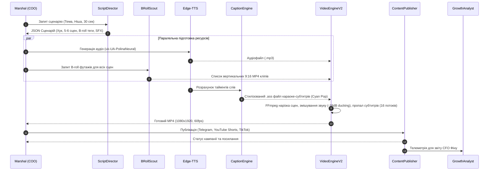

# 🏭 SYNDICATE Content Factory v2.0 — Архітектура та Керівництво

## 1. Загальний огляд

**Content Factory v2.0** — це автономний конвеєр виробництва мультимедійного контенту холдингу **SYNDICATE**, розрахований на нульові постійні витрати на програмне забезпечення ($0 SaaS fees). Конвеєр працює локально на сервері **Contabo VPS (16 vCPU / 48 GB RAM)**, використовуючи багатопотоковий FFmpeg, безкоштовний Edge-TTS та прямі API дистрибуції.

---

## 2. Структура модулів (`src/departments/content_factory/`)

```
src/departments/content_factory/
├── __init__.py               # Експорт компонентів заводу
├── script_director.py        # Режисер вірусних сценаріїв (Grok LLM + Hook/Pacing)
├── broll_scout.py            # Автоматичний скаут вертикального B-roll (Pexels / Pixabay)
├── caption_engine.py         # Генератор динамічних караоке-субтитрів Hormozi-style (.ass)
├── video_engine_v2.py        # 16-потоковий мульти-сценічний FFmpeg асемблер
├── publisher.py              # Мульти-канальний диспетчер (Shorts, TikTok, Telegram)
├── grok_writer.py            # Копірайтер тредів та коментарів для X (Twitter) та Threads
├── mockup_studio.py          # Автоматичний композитор мокапів для Print On Demand (Pillow)
└── video_producer.py         # Легасі-компоновщик v1.0
```

---

## 3. Автономний виробничий цикл (End-to-End Pipeline)



---

## 4. Специфікація ключових модулів

### 4.1. `ScriptDirector` (`script_director.py`)
- **Формула утримання:**
  - `0–3 сек:` Контрарний візуальний та смисловий хук.
  - `3–25 сек:` Щільна корисна інформація з розбивкою на сцени по 2.5–3.5 секунди.
  - `25–30 сек:` Відкритий цикл (open loop), заклик до дії (CTA) та безшовний перехід на початок ролика.
- **Вихідний формат:** Суворий JSON із ключовими словами для пошуку B-roll, звуковими ефектами (`whoosh`, `sub_bass`, `ding`, `cash_register`) та SEO-тегами.

### 4.2. `BRollScout` (`broll_scout.py`)
- **Джерела:** Pexels Video API (безкоштовно 200 req/hour) та Pixabay Video API.
- **Фільтри:** Орієнтація `portrait` (9:16), якість HD.
- **Локальний кеш:** `media/broll_cache/` (хешування за ключовими словами, повторні запити не споживають інтернет).
- **Синтетичний Fallback:** Генерація абстрактних рухомих фонів FFmpeg (`mptestsrc` / градієнти) у разі відсутності зв'язку.

### 4.3. `CaptionEngine` (`caption_engine.py`)
- **Стиль Hormozi / Karaoke Pop:**
  - Формат: Advanced SubStation Alpha (`.ass`).
  - Активне слово спалахує фірмовим неоново-блакитним кольором (`&H00FFFF00`) або золотим (`&H0000FFFF`).
  - Шрифт: `Montserrat ExtraBold` / `Impact`.
  - Чорний контур 5px та напівпрозора тінь для читабельності на будь-якому фоні.
  - Безпечна зона: відступ `margin_v=480` (не перекривається інтерфейсом TikTok/Reels).

### 4.4. `VideoEngineV2` (`video_engine_v2.py`)
- **Рендеринг:**
  - 16 процесорних потоків (`-threads 16`).
  - Кодек `libx264`, пресет `veryfast`, якість `crf 22`.
  - Автоматичне приглушення музики під голос диктора (`amix=inputs=2:dropout_transition=2`).
  - Час рендерингу 30-секундного ролика на Contabo VPS: **12–18 секунд**.

### 4.5. `ContentPublisher` (`publisher.py`)
- **Канали:**
  - **Telegram:** Пряме завантаження відео з розміткою Markdown через Bot API.
  - **YouTube Shorts:** Інтеграція з YouTube Data API v3 з додаванням обов'язкового тегу `#Shorts`.
  - **TikTok / Reels:** Диспетчер сесій.

---

## 5. Команди виклику через Floor2Coordinator / Маршала

```python
from src.departments.coordinator import Floor2Coordinator

coordinator = Floor2Coordinator()

# 1. Повний автономний запуск створення вірусного Shorts
result = await coordinator.execute({
    "action": "create_viral_short",
    "topic": "Як запустити автономний AI холдинг",
    "niche": "ai_automation",
    "duration_sec": 30,
    "voice": "uk-UA-PolinaNeural",
    "caption_style": "hormozi_cyan"
})

# 2. Окреме створення сценарного плану
script_blueprint = await coordinator.execute({
    "action": "direct_short_script",
    "topic": "Топ-3 помилки при виборі SaaS у 2026",
    "duration_sec": 45
})

# 3. Дистрибуція готового ролика
publish_res = await coordinator.execute({
    "action": "publish_content_campaign",
    "video_path": result["video_path"],
    "seo_metadata": result["seo_metadata"]
})
```

---

## 6. Змінні оточення (.env)

| Змінна | Призначення | Обов'язкова |
| :--- | :--- | :--- |
| `XAI_API_KEY` | Ключ до xAI Grok для генерації сценаріїв | Ні (є вбудований шаблонний генератор) |
| `PEXELS_API_KEY` | Безкоштовний ключ до Pexels Video API | Ні (є синтетичний B-roll генератор) |
| `PIXABAY_API_KEY` | Безкоштовний ключ до Pixabay Video API | Ні |
| `TELEGRAM_BOT_TOKEN` | Токен бота для публікації у канал | Ні (є dry-run емуляція) |
| `TELEGRAM_CHANNEL_ID` | ID або @username каналу (напр. `@syndicate_holding`) | Ні |
| `YOUTUBE_CREDENTIALS_PATH` | Шлях до OAuth2 JSON файлу YouTube Data API | Ні |
