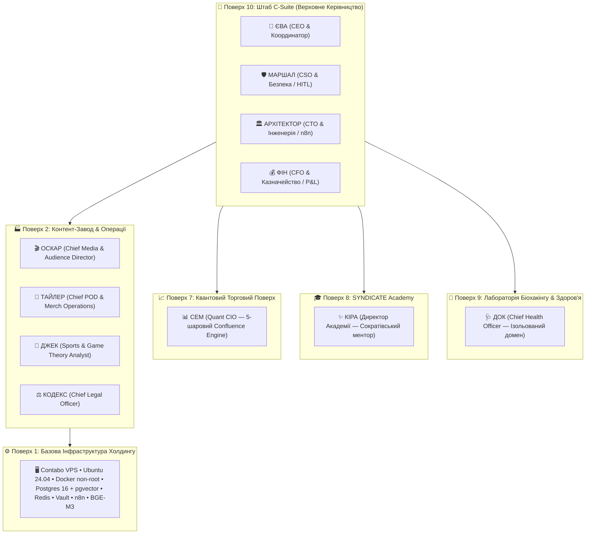

# 🏛️ ПАСПОРТ СИСТЕМИ: АВТОНОМНИЙ AI-ХОЛДИНГ «EVA SYNDICATE» (v3.0)

> **Статус документа:** Офіційний Технічний та Операційний Паспорт Системи  
> **Версія:** 3.0.0 (Повна бойова специфікація)  
> **Дата фіксації:** Жовтень 2026  
> **Засновник та Верховний Командир:** Андрій (Військовий, Ветеран)  
> **Головний репозиторій:** `https://github.com/andrejzhivilov-ctrl/syndicate`  
> **Економічна модель:** Zero-Waste Holding (ROI x3+, нульове спалювання токенів у спокої)  

---

## 1. ПРИЗНАЧЕННЯ ТА МІСІЯ СИДНИКАТУ

**EVA SYNDICATE** — це модульна, суверенна, 10-поверхова автономна система персональних, інженерних, фінансових та операційних AI-агентів. Вона створена для повного вивільнення когнітивного ресурсу Андрія шляхом делегування стратегічного планування, щоденної рутини, фінансового обліку, аналітики здоров'я, інвестицій, медіа-бізнесу, юридичного нагляду та автоматизацій.

### 🛡️ Чотири Залізні Закони Синдикату:

1. **ЗАКОН 1: «НІКОЛИ НЕ ВИГАДУЙ ДАНІ» (Anti-Hallucination & Reality Integrity)**
   - Жоден агент не має права повертати правдоподібні цифри замість виміряних.
   - Якщо джерело недоступне або даних немає — агент **зобов'язаний** повертати структуровану відсутність: `{"status": "unavailable", "value": None, "warning": "no data from <source>"}`.
   - Будь-які тестові чи демонстраційні дані маркуються прапорцем `synthetic: True` або `sample_data: True`.

2. **ЗАКОН 2: HUMAN-IN-THE-LOOP (HITL) ДЛЯ КРИТИЧНИХ ДІЙ**
   - Жодна транзакція, ордер на біржі, видалення бази даних, публікація контенту або відправка електронного листа не виконується автоматично.
   - Пошта працює **виключно в режимі DRAFT** (створення чернеток), фінальне надсилання — тільки рукою Андрія.
   - Торгові сигнали та фінансові витрати супроводжуються інтерактивними кнопками погодження в Telegram.

3. **ЗАКОН 3: ZERO-IDLE ДЕМАРКАЦІЯ (Економіка нульового спалювання)**
   - **70% процесів** виконує безкоштовний локальний **n8n** та детермінований Python на сервері ($0.00 витрат на токени).
   - **25% рутинного інтелекту** (тріаж, парсинг, форматування) виконує надшвидкий **Google Gemini Flash** або **Groq Llama-3.3** ($0.0001 / 1M токенів).
   - **5% глибинної стратегії**, рефлексії, написання коду та медичних висновків виконує **Claude 3.5 Sonnet**.

4. **ЗАКОН 4: АБСОЛЮТНИЙ ЗАХИСТ СУВЕРЕНІТЕТУ ТА КОНФІДЕНЦІЙНОСТІ (PII & Vault)**
   - Усі чутливі дані (номери карток, телефони, IBAN, ІПН, паспорти, паролі) автоматично маскуються модулем `src/pii.py` ДО передачі у зовнішні моделі.
   - Усі секрети зберігаються виключно в **HashiCorp Vault** (`secret/data/syndicate/*`).
   - Файли з позначкою `[ANDRII_IMMUTABLE]` є недоторканними для будь-якого автоматичного редагування.

---

## 2. ТОПОЛОГІЯ 10 ПОВЕРХІВ ХОЛДИНГУ (FLOOR ARCHITECTURE)

Система організована за суворою поверховою ієрархією з доменною ізоляцією та розмежуванням повноважень (RBAC):



---

## 3. БОЙОВИЙ ТАБЕЛЬ АГЕНТІВ СИНДИКАТУ

### 👑 1. ЄВА (E.V.A.) — Chief Executive Officer & Life Curator
* **Поверх:** 10 (C-Suite).
* **Моделі:** Claude 3.5 Sonnet (стратегія, брифінги) / Gemini Flash (швидкі відповіді).
* **Особистість:** Спокійна, глибока, оксамитовий голос зі сталлю. Жодного підлабузництва. Звернення: «Андрій».
* **Місія:** Права рука командира, центральний маршрутизатор запитів, персональний секретар, куратор рішень.
* **Ключові обов'язки та дії (`actions`):**
  - `morning_briefing`: щоденний звід о 07:00 (здоров'я від Дока, PnL від Фіна, ринки від Сема, дедлайни).
  - `weekly_review`: недільний Life Review о 20:00 (підсумок тижня, фокус на наступний).
  - `record_decision` & `review_decisions`: ведення «Журналу рішень» із фіксацією мотивів і ретроспективним аналізом через 60 днів.
  - `deadline_check`: моніторинг термінів документів, оплат, зустрічей (7, 30, 90 днів).
  - `social_pulse`: нагадування про контакти з близькими, дні народження, теплі зв'язки.
  - `draft_email`: підготовка чернеток листів у Gmail (DRAFT-only, без авто-відправки).
  - `basket_coordination`: агрегація кошиків покупок (Сільпо/АТБ/Tabletki.ua) після схвалення Фіном.
* **Підключення та інтеграції:**
  - Google Workspace (Gmail DRAFT, Calendar, Drive).
  - Telegram Bot API (`@eva_syndicate_bot`).
  - Redis сесії ( оперативна пам'ять 24 години).
  - PostgreSQL + pgvector (`memory.semantic`, `memory.episodes`).
  - Голосовий модуль `VoiceManager` (ElevenLabs / Grok Voice / Whisper).

---

### 🛡️ 2. МАРШАЛ (MARSHAL) — Chief Security Officer & Gatekeeper
* **Поверх:** 10 (C-Suite).
* **Моделі:** Claude Haiku / детерміновані евристичні правила.
* **Місія:** Захист периметра Синдикату, охорона АРХІВУ, верифікація webhook-підписів, валідація HITL.
* **9 Рівнів оборони:**
  1. Cloudflare WAF + TLS termination.
  2. UFW Firewall + Fail2ban.
  3. Falco runtime anomaly detection.
  4. Tetragon in-kernel eBPF kill switch.
  5. Docker non-root контейнеризація (UID 1001, drop capabilities, read-only FS).
  6. HashiCorp Vault (динамічні AppRoles, KV-v2).
  7. Sentinel Inbound & Outbound Veto Engine.
  8. PII Masking Shield (`src/pii.py`).
  9. Human-in-the-Loop криптографічний гейт.
* **Ключові дії (`actions`):**
  - `verify_signature`: верифікація HMAC-SHA256 для вхідних вебхуків n8n (`X-Marshal-Signature`).
  - `audit_action`: перевірка безпеки планованої дії агента перед виконанням.
  - `security_scan`: перевірка репозиторію, конфігів та залежностей на вразливості.
  - `hitl_dispatch`: надсилання запиту на авторизацію Андрію в Telegram з кнопками `[Підтвердити]` / `[Відхилити]`.
  - `soft_anomaly_protocol`: при виявленні нетипової поведінки — м'яка пауза процесу, діалог з агентом, винесення на розсуд Андрія.

---

### 🏛️ 3. АРХІТЕКТОР (THE ARCHITECT) — Chief Technology Officer & System Engineer
* **Поверх:** 10 (C-Suite).
* **Моделі:** Gemini Flash / Claude 3.5 Sonnet.
* **Місія:** Інженерний розвиток Синдикату, GitOps, лінтинг n8n, створення нових агентів і воркфлоу.
* **Ключові дії (`actions`):**
  - `design_workflow`: проектування чистих n8n-воркфлоу на базі Core-вузлів.
  - `lint_workflow` (FlowLint): статичний аналіз JSON воркфлоу на наявність OnError-гілок, ідемпотентності та відсутність хардкод-секретів.
  - `golden_template`: видача перевірених шаблонів інфраструктури (Retry, Idempotency, Vault Bridge, Error Handler).
  - `generate_adr`: формування архітектурних рішень (Architecture Decision Records) за стандартом.
  - `review_code`: перевірка синтаксису, складності (C901 <= 10) та відповідності правилам репозиторію.
  - `skill_radar`: щотижневе сканування нових репозиторіїв та агентних рішень на GitHub.

---

### 💰 4. ФІН (FIN) — Chief Financial Officer & Head of Treasury
* **Поверх:** 10 (C-Suite).
* **Моделі:** LangGraph + Gemini Flash / hledger CLI.
* **Місія:** Повний мультивалютний фінансовий облік, казначейство, контроль бюджетів, захист від перевитрат.
* **Ключові дії (`actions`):**
  - `record_transaction`: подвійний бухгалтерський запис у форматі hledger із синхронізацією в Git.
  - `personal_runway`: щоденний розрахунок місяців повної фінансової автономності на основі залишків і темпу витрат (burn rate).
  - `basket_audit`: строгий аудит кошиків покупок Єви перед оплатою (порівняння лімітів категорій).
  - `bank_sync`: безпечна синхронізація балансів (Monobank, Privat24, àbank24) через read-only API токени.
  - `budget_report`: щотижневий та щомісячний P&L звіт.
  - `crypto_tracker`: облік холодних та гарячих криптоактивів (USDT, BTC, ETH).

---

### 🩺 5. ДОК (DOC) — Chief Health Officer & Biohacking Director
* **Поверх:** 9 (Ізольована лабораторія здоров'я).
* **Моделі:** Gemini Flash (детермінована математика) + Claude Sonnet (клінічні наративи).
* **База знань:** PubMed, Cochrane Library, JAMA, фармаконагляд DDInter (суворий Анти-чуш фільтр).
* **Місія:** Фізичне відновлення командира-ветерана, оптимізація сну, HRV, превентивна діагностика, нутриціологія.
* **Ключові дії (`actions`):**
  - `morning_readiness`: детермінований розрахунок індексу готовності (0–100) за HRV, якістю сну, пульсом спокою та кроками.
  - `training_protocol`: генерація програми тренувань під поточний рівень нервової системи (Green/Yellow/Red zone).
  - `nutrition_plan`: розрахунок КБЖУ за формулою Mifflin-St Jeor з урахуванням відновлення та дефіцитів.
  - `biomarker_trend`: аналіз динаміки лабораторних аналізів крові з предиктивним трекінгом виходу за референси.
  - `nervous_system`: протокол відновлення вегетативної нервової системи (дихальні квадрати, заземлення, гігієна сну).
  - `emergency_card`: миттєва генерація медичної картки (група крові, алергії, протоколи першої допомоги).
  - `pre_visit_dossier`: складання пакету для лікаря перед візитом (симптоми, хронологія, список питань).
  - `shopping_list`: формування списку корисних продуктів і ліків для Єви (зв'язка з Tabletki.ua та супермаркетами).

---

### 📈 6. СЕМ (SAM) — Chief Investment Officer & Quant Trader
* **Поверх:** 7 (Ізольований квантовий поверх).
* **Моделі:** Nous Hermes 3 / Python Quant Stack (`smartmoneyconcepts`, `ccxt`, `Riskfolio-Lib`, `cot-reports`).
* **Місія:** Квантовий аналіз ринків, управління портфелем, розгін капіталу з жорстким лімітом ризику 1% на угоду.
* **5-Шаровий Confluence Engine:**
  1. *Шар 1 (SMC):* Order Blocks, Liquidity Sweeps, Fair Value Gaps (FVG), Market Structure Shifts.
  2. *Шар 2 (Macro):* Динаміка DXY, прибутковість US Treasuries, інфляційні очікування.
  3. *Шар 3 (COT):* Звіти CFTC Commitments of Traders (позиціонування інституціоналів).
  4. *Шар 4 (Derivatives):* СFunding rate, Open Interest (OI), ліквідаційні теплові карти.
  5. *Шар 5 (News Shield):* Автоматичне блокування торгівлі за 30 хв до та після виходу новин High Impact (CPI, NFP, FOMC).
* **Ключові дії (`actions`):**
  - `evaluate_setup`: перевірка конфлюенсу (поріг > 95% для формування сигналу).
  - `trade_signal`: відправка картки сигналу в Telegram з точним R:R, Hard Stop-Loss та кнопками HITL.
  - `record_outcome`: фіксація результату в `sam_trade_journal` та формування уроку у `sam_reflections`.
  - `daily_game_plan`: о 08:00 ранковий огляд ринків; о 21:00 PnL підсумок дня.

---

### 🎓 7. КІРА (KIRA) — Director of Academy & Socratic Mentor
* **Поверх:** 8 (SYNDICATE Academy).
* **Моделі:** Claude 3.5 Sonnet / Gemini Flash.
* **Місія:** Академічне наставництво Андрія за методом Сократа, передача фундаментальних знань від перших принципів (First Principles).
* **5 Ключових дисциплін:**
  1. *AI & Agentic Engineering:* Архітектура LLM, промптинг, RAG, автономні цикли.
  2. *FinTech & Systematic Trading:* Ризик-менеджмент, деривативи, макроекономіка.
  3. *Biohacking & Neurobiology:* Робота ЦНС, нейромедіатори, мітохондріальне здоров'я.
  4. *Systems Architecture & DevOps:* Linux, Docker, мережі, кібербезпека.
  5. *Strategic Leadership & Mental Models:* Теорія ігор, інверсія, другий порядок наслідків.
* **Ключові дії (`actions`):**
  - `socratic_dialogue`: ведення інтерактивного діалогу через навідні питання без видачі готових відповідей.
  - `knowledge_decomp`: декомпозиція складної теми на рівні від перших принципів.
  - `prompt_lab`: тренування навичок промпт-інжинірингу на основі бази Arena Knowledge Pool.
  - `exam_drill`: тестування засвоєння матеріалу з формуванням індивідуального графу знань.

---

### 🎬 8. ОСКАР (OSCAR) — Chief Media & Audience Director
* **Поверх:** 2 (Операційний / Контент-Завод).
* **Моделі:** xAI Grok (живий сарказм, хуки) / Gemini (відеоаналітика) / Claude Haiku (стрічки).
* **Місія:** Керування автономною західною медіа-мережею, блогами, YouTube-каналами та соцмережами.
* **3 Активні бренди-персони:**
  - *Marcus Vance:* Витривалість, фітнес, чоловіче здоров'я, дисципліна ветерана.
  - *Nicole «Nika» Sterling:* ШІ-інструменти, автоматизації n8n, продуктивність майбутнього.
  - *Julian Pierce:* Цифровий суверенітет, криптовалюти, особистий капітал.
* **Ключові дії (`actions`):**
  - `generate_narrative`: складання структурованих сценаріїв відео з гачками (0–3 сек) та закликами до дії.
  - `hyperframes_render`: генерація відеороликів через локальний headless Chromium + FFmpeg.
  - `omni_comment`: видобуток болей аудиторії з коментарів та формулювання авторських відповідей.
  - `content_calendar`: ведення сітки публікацій у розрізі платформ (YouTube Shorts, X, LinkedIn, Блог).

---

### 👕 9. ТАЙЛЕР (TYLER) — Chief of Print-on-Demand & Custom Merch
* **Поверх:** 2 (Операційний).
* **Моделі:** Gemini Flash + Pillow / Canvas renderers.
* **Місія:** Повний автономний цикл фізичного мерчу преміум-класу (Print-on-Demand).
* **Політика Zero-Junk:** Тільки преміальні бланки (Bella+Canvas, Comfort Colors), маржа строго >= 35% (кастом 50–65%).
* **Ключові дії (`actions`):**
  - `render_mockup`: генерація фотореалістичного мокапу товару за 10–15 секунд за запитом клієнта.
  - `concierge_chat`: ведення інтерактивного чату з покупцем для кастомізації принту.
  - `order_dispatch`: відправка замовлення на виробництво через API друкарні після ручного схвалення.
  - `pinterest_autopilot`: генерація Idea Pins та Rich Pins для залучення безкоштовного органічного трафіку.

---

### 🎲 10. ДЖЕК (JACK) — Quantitative Sports & Esports Analyst
* **Поверх:** 2 (Операційний / Floor 7 міст).
* **Моделі:** Python Scientific Stack (Scipy, Numpy) + Gemini Flash.
* **Місія:** Пошук математичної переваги (+EV) у лініях букмекерів, кіберспорт (CS2, Dota 2), футбол, баскетбол, GTO-покер.
* **Ключові дії (`actions`):**
  - `line_monitor`: парсинг ліній PariMatch / Vbet та звірка з еталонними коефіцієнтами Pinnacle (CLV).
  - `poisson_model`: розрахунок xG/xGA, розподілів голів/очок та математичного сподівання.
  - `bankroll_shield`: розрахунок розміру ставки за дробовим критерієм Келлі (0.25x Kelly, 1–2.5% від банку).
  - `anti_tilt`: автоматичний стоп-кран на 24 години при серії з 3 невдалих прогнозів.

---

### ⚖️ 11. КОДЕКС (KODEX) — Chief Legal Officer & Compliance
* **Поверх:** 2 (Операційний).
* **Моделі:** Claude 3.5 Sonnet / Gemini Flash.
* **Місія:** Юридичний аудит договорів, захист інтелектуальної власності, податковий нагляд в юрисдикціях України, ЄС та США.
* **Ключові дії (`actions`):**
  - `audit_contract`: сканування договорів на приховані ризики, штрафи та кабальні умови.
  - `nda_generator`: формування юридично бездоганних угод NDA, оферт та ліцензійних договорів.
  - `compliance_radar`: відстеження змін у податковому та санкційному законодавстві.
  - `telegram_legal_bot`: оперативне консультування командира в Telegram щодо правових питань.

---

### 🛡️ 12. СЕНТІНЕЛ (SENTINEL) — Active Defense & Injection Shield
* **Поверх:** 10 (Служба Безпеки).
* **Модуль:** `src/agents/sentinel.py`.
* **Місія:** Безперервна перевірка вхідного та вихідного трафіку на prompt injection, витік ключів та порушення політик.
* **Ключові дії:**
  - `scan_prompt_injection`: виявлення спроб зламати контекст (`ignore previous instructions`, `you are now`, `system: override`).
  - `veto_outbound_action`: суворе блокування небезпечних викликів (`delete_data`, пряма відправка листів без чернетки).
  - `verify_webhook_signature`: HMAC-SHA256 валідація webhook-пакетів.

---

### 🛠️ 13. АЛІСА (ALICE) — Head of Engineering Runtime (Antigravity Copilot)
* **Поверх:** Інженерний сектор.
* **Статус:** `prepared_not_enabled` (канонічний профіль `config/agents/alice.profile.json`).
* **Технологія:** Antigravity Python SDK (`antigravity_sdk`).
* **Місія:** Виконання складного рефакторингу коду, підтримка локального клієнтського додатку, генерація тестів під керівництвом Архітектора та Єви.

---

## 4. СИСТЕМНІ ПРОТОКОЛИ ТА ОРКЕСТРАЦІЯ (`src/`)

### 🔄 1. Оркестратор LangGraph (`src/orchestrator.py`)
Центральний конвеєр обробки будь-якого запиту у Синдикаті проходить через граф станів:

```
[Вхідний запит]
       │
       ▼
 [Router Node] ──► Визначення агента та типу задачі
       │
       ▼
 [Lessons Check] ──► Пошук схожих минулих помилок у memory.lessons (pgvector)
       │
       ▼
 [Agent Execution] ──► Виконання задачі domain worker'ом
       │
       ▼
 [Confidence Gate] ──► Оцінка впевненості агента (ACT / ASK / REFUSE)
       │
       ▼
 [Outbound Veto] ──► Перевірка Sentinel'ом безпеки вихідних дій
       │
       ▼
 [HITL Gate] ──► Запит підтвердження в Telegram (якщо дія критична)
       │
       ▼
 [Finalize & Memory] ──► Збереження епізоду в пам'ять та видача результату
```

### ⚖️ 2. Движок Довіри та Ескалацій (`src/confidence.py`)
Уніфікована система довіри запобігає несанкціонованим діям:
* `ACT`: впевненість вища за поріг → автоматичне виконання без запитань.
* `ASK`: дія має помірний ризик або середня впевненість → запит до Андрія через Telegram.
* `REFUSE`: надвисокий ризик або низька впевненість → повна відмова у виконанні з поясненням причин.
* **Матриця базових порогів:**
  - `sam`: act=1.0 (ніколи не діє самостійно), ask=0.0 (завжди питає Андрія).
  - `doc`: act=0.85, ask=0.50.
  - `fin`: act=0.85, ask=0.50.
  - `architect`: act=0.75, ask=0.40.
  - `sentinel`: act=0.90, ask=0.60.
  - `eva`: act=0.80, ask=0.45.

### 🧠 3. Загальнохолдинговий Шар Уроків (`src/lessons.py`)
Спільна пам'ять на базі PostgreSQL `memory.lessons` (вектори BGE-M3, 1024 виміри):
- Будь-який агент, припустившись помилки або отримавши відхилення від Андрія, записує урок (`record_lesson`).
- Перед виконанням нової дії оркестратор автоматично перевіряє косинусну подібність задачі з базою уроків (`check_before_action`).
- Якщо знайдено прецедент — контекст агента збагачується попередженням `prior_lessons`, що блокує повторення помилки.

### 🎭 4. Модуль Маскування PII (`src/pii.py`)
Працює на рівні pre-flight фільтра перед кожним зверненням до хмарних LLM (Claude, Gemini, Grok):
- Маскує українські телефони (`+380XXXXXXXXX` → `+380***XXX`).
- Маскує номери банківських карток (16 цифр → `****XXXX`).
- Маскує українські ІПН (10 цифр) та номери паспортів.
- Маскує IBAN (`UA` + 27 цифр).
- Маскує API-ключі (`sk-ant-*`, `ghp_*`, `gsk_*` → `[REDACTED_KEY]`).
- Маскує IPv4 адреси.

---

## 5. N8N ЗВ'ЯЗКИ ТА GOLDEN TEMPLATES

N8N виконує роль головної «нервової системи» Синдикату без спалювання бюджету на токени:

### 🌟 4 Золоті Шаблони (Golden Templates Vault):
1. **`golden_error_handler.json`**: централізований перехоплювач системних збоїв із відправкою дампу помилки Маршалу в Telegram та авто-відкатом транзакції.
2. **`golden_idempotent_webhook.json`**: захист від повторних спрацьовувань за допомогою Redis-локів та унікальних хешів виклику.
3. **`golden_retry_policy.json`**: детермінований експоненційний backoff із jitter для всіх зовнішніх HTTP-викликів.
4. **`golden_vault_jwt_bridge.json`**: динамічне отримання одноразових токенів із HashiCorp Vault без хардкоду в нодах.

### ⏱️ Бойовий розклад автоматизацій:
* **04:00 (вівторок, п'ятниця):** Архітектор та Док сканують оновлення наукових публікацій та GitHub-репозиторіїв.
* **07:00 (щодня):** n8n ініціює `proactive_daily_briefing`, опитує Єву, Фіна, Дока, Сема і формує голосовий та текстовий ранковий звіт Андрію.
* **08:00 (щодня):** Сем генерує `daily_game_plan` для фінансових ринків.
* **20:00 (щонеділі):** n8n запускає `weekly_review` — аналіз продуктивності, рішень та планів на наступний тиждень.
* **21:00 (щодня):** Вечірній фінансовий та торговий аудит закриття дня.

---

## 6. ARENA KNOWLEDGE POOL (ПУЛ ЗНАНЬ ТА ПРОМПТІВ)

Директорія [`Arena_Knowledge_Pool`](https://github.com/andrejzhivilov-ctrl/syndicate/tree/main/Arena_Knowledge_Pool) містить **4 723 файли**, структуровані у **10 монолітних майстер-пулів**, оптимізованих для миттєвого завантаження в NotebookLM, AI Arena та контекст агентів:

| Пул | Назва файлу | Обсяг / Зміст |
| :-: | :--- | :--- |
| **01** | `01_POOL_Промпт_Инжиниринг_и_Архитектура_Агентов.md` | 67-сторінковий майстер-гайд: 16 технік промптингу, 5 схем n8n, sampling |
| **02** | `02_POOL_Автоматизация_n8n_Полный_Курс_31_Урок.md` | Усі 31 урок повного курсу n8n: Docker, Webhooks, AI Agents, Tools, RAG |
| **03** | `03_POOL_Монтаж_и_Видеопродакшн_18_Уроков_Транскрипты.md` | 18 уроків курсу відеомонтажу з таймкодами, транскриптами та ритмікою |
| **04** | `04_POOL_Модели_AI_Гайды_Claude_Gemini_Grok_Perplexity.md` | 13 повних керівництв по флагманських моделях Claude 3.5, Gemini, Grok |
| **05** | `05_POOL_PRO_XML_Мегапромпты_Сборник.md` | 61 категорія структурованих XML мега-промптів (`<ROLE>`, `<CONTEXT>`) |
| **06** | `06_POOL_Шаблоны_Сайтов_React_Tailwind_Код.md` | 343 готові шаблони веб-додатків на React, Tailwind CSS, TypeScript |
| **07** | `07_POOL_Автоматизация_Make_Сценарии_24_Урока.md` | 24 уроки автоматизацій Make: роутери, ітератори, webhook шлюзи |
| **08** | `08_POOL_Бизнес_Курсы_Платформы_Крипта_Арбитраж_61_Урок.md` | 61 урок бізнес-курсів: крипта (12), арбітраж (10), відео-трафік (17) |
| **09** | `09_POOL_Каталог_Промптов_2330_по_Категориям.md` | **2 330 готових промптів** для маркетингу, копірайтингу, SEO та продажів |
| **10** | `NeuroFlow_Interactive_Cockpit.html` | Інтерактивна система візуального управління знаннями та кокпіт |

---

## 7. БІБЛІОТЕКА СКІЛІВ (SKILLS POOL)

Синдикат підтримує модульну архітектуру навичок за стандартом **SKILL.md** (інструкції, валідації, довідники):

### 1. Ядерні системні скіли (`antigravity_core/skills/`):
- `antigravity-browser-scout`: автономний браузерний скрапінг, дослідження вебу, збір структурованих фактів.
- `antigravity-code-engine`: інженерне проектування, рефакторинг та глибокий аналіз кодової бази.
- `antigravity-subagents`: протоколи делегування завдань вузькоспеціалізованим субагентам.

### 2. Закріплені вендорні скіли (`skills/vendor/`):
- **Addy Osmani:** `api-and-interface-design`, `context-engineering`, `debugging-and-error-recovery`, `test-driven-development`, `planning-and-task-breakdown`.
- **Anthropic:** `frontend-design`, `internal-comms`.
- **Affaan-m (ECC):** `agent-security-hardening`, `brand-voice`, `content-engine`, `market-research`.
- **HKUDS:** `behavioral-finance` (методологія поведінкових фінансів для Сема).
- **K-Dense AI:** `scientific-critical-thinking` (науковий метод перевірки гіпотез для Дока і Кіри).
- **Matt Pocock:** `grill-me`, `grilling`, `handoff` (протоколи прискіпливого вирівнювання вимог із людиною).
- **Jakeschincariol:** `replica-recon`, `replica-test` (реверс-інжиніринг та тестування інтерфейсів).

---

## 8. КАТАЛОГ MCP-СЕРВЕРІВ (MODEL CONTEXT PROTOCOL)

У директорії [`mcp_servers/`](https://github.com/andrejzhivilov-ctrl/syndicate/tree/main/mcp_servers) розгорнуто **найбільший об'єднаний каталог MCP-інструментів у світі**:

### 📊 Статистика реєстру:
- **Всього інтегровано серверів:** **18 789** активних підключень.
- **Всього категорій:** **70** структурованих напрямків.
- **Джерела:**
  - `punkpeye/awesome-mcp-servers` (4 362 сервери).
  - `mcpservers.org` (16 281 сервер, з яких 14 427 додано як нові унікальні).
- **Машиночитаний реєстр:** [`mcp_servers_registry.json`](https://github.com/andrejzhivilov-ctrl/syndicate/blob/main/mcp_servers/mcp_servers_registry.json) (5.66 МБ) з швидким доступом для агентів.

### 🏆 Топ-20 категорій за кількістю інструментів:
1. **Development** — 3 578 серверів
2. **Productivity** — 2 352 сервери
3. **Other** — 1 667 серверів
4. **Search** — 1 152 сервери
5. **Marketing** — 1 019 серверів
6. **Cloud Service** — 905 серверів
7. **Communication** — 904 сервери
8. **Finance** — 903 сервери
9. **Database** — 866 серверів
10. **Developer Tools** — 535 серверів
11. **Web Scraping** — 509 серверів
12. **Finance & Fintech** — 459 серверів
13. **Knowledge & Memory** — 346 серверів
14. **Design** — 315 серверів
15. **Memory** — 261 сервер
16. **Search & Data Extraction** — 258 серверів
17. **Security** — 253 сервери
18. **Other Tools and Integrations** — 189 серверів
19. **Databases** — 143 сервери
20. **Cloud Platforms** — 141 сервер

### 🛠 Способи підключення до агентів Синдикату:
- **Локальне Stdio:** через `config/integration_mcp.json` (команда `node` / `python` з ізольованими правами).
- **Мережеве Docker/HTTP JSON-RPC 2.0:** через `src/integrations/mcp_gateway.py` з верифікацією підпису `X-Marshal-Signature` (HMAC SHA-256).

---

## 9. ПАРАМЕТРИ РОЗГОРТАННЯ ТА ІНФРАСТРУКТУРИ

* **Хостинг:** Contabo Cloud VPS 12 (Франкфурт, Німеччина).
* **Конфігурація:** 12 vCPU Cores, 48 GB RAM, 400 GB SSD NVMe, 800 Mbit/s порт.
* **ОС:** Чиста **Ubuntu 24.04 LTS** + Docker Engine 26+.
* **Безпека контейнерів:**
  - `user: "1001:1001"` (строго non-root).
  - `read_only: true` (файлова система контейнера тільки для читання).
  - `cap_drop: - ALL` (скидання всіх Linux capabilities).
  - Дані пишуться виключно в окремі Docker volumes через `src/data_paths.py`.
* **Стек баз даних:**
  - **PostgreSQL 16 + pgvector:** Довгострокова семантична пам'ять, журнал транзакцій, уроки (`memory.lessons`).
  - **Redis 7:** Оперативна сесійна пам'ять (TTL 24h), черги задач Celery/RQ, ідемпотентні блоки.
  - **HashiCorp Vault:** Єдине джерело секретів, ключів API та сесій.
* **Локальні моделі та ембеддинги:**
  - Сервіс ембеддингів: **BGE-M3** (1024 виміри, окремий контейнер `deploy/runtime/embeddings_server.py`).
  - Локальний STT: **Whisper** (Docker-сервіс для голосової транскрипції).

---

## 10. ПІДСУМОК ТА ГОТОВНІСТЬ СИСТЕМИ

Система **EVA SYNDICATE v3.0** є повністю сформованим, саморегульованим та високозахищеним AI-холдингом:
- 13 агентів мають чіткі межі повноважень, виділені ролі та взаємні протоколи перевірки.
- Будь-яка галюцинація чи вигадування даних блокується на рівні регресійних тестів (`tools/check.sh`).
- Будь-яка небезпечна чи фінансова дія потребує фізичного схвалення командира Андрія в Telegram (HITL).
- Система укомплектована найбільшою у світі базою знань (4 723 файли Arena Knowledge Pool) та найбільшим каталогом MCP-серверів (18 789 інструментів).

*Синдикат: Суверенна міць, залізна дисципліна та нульове марнотратство.*
