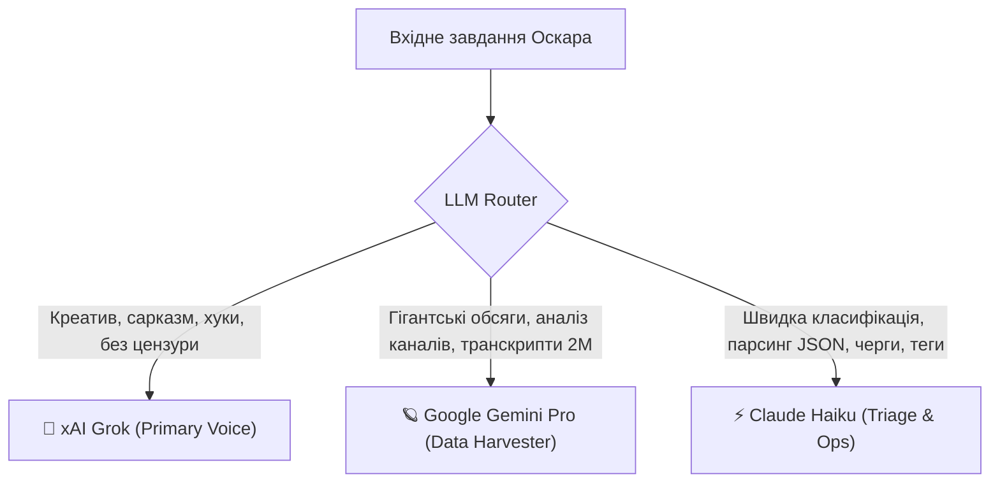

# 🎬 АГЕНТ «ОСКАР» (OSCAR) — CHIEF MEDIA & AUDIENCE DIRECTOR
## Специфікація автономної медіа-директорії (Floor 2+) для SYNDICATE

> **Agent ID:** `oscar`  
> **Повна назва:** **OSCAR** (*Omni-channel Syndicate Content & Audience Robot*)  
> **Роль в екосистемі:** Автономний керівник медіа-імперії, створення контенту, дослідження болей ринку, монетизація та робота зі спільнотою.  
> **Статус:** Архітектурна специфікація для реалізації бекенду (Arena Agent).

---

## 1. Загальна концепція та філософія

ОСКАР — це не статичний бот і не банальний генератор текстів. Це **автономний медіа-директор нового покоління**, який веде мережу нішевих медіа-активів (сайти, соціальні мережі, відеохостинги, поштові розсилки), самостійно вивчає ринок, препарує канали конкурентів, чує кожен шепіт у коментарях і вибудовує продажі через психологічну ініціацію (Inception-selling).

### Головні принципи:
1. **Multi-Persona Matrix:** Один потужний аналітичний центр виступає назовні під абсолютно різними персонажами зі своїм унікальним голосом, аватаром, лексикою та темпераментом.
2. **Абсолютна відсутність спаму та «впарювання»:** Продаж відбувається через розкриття глибинного болю та пропозицію єдиного логічного рішення. Клієнт хоче придбати продукт ще до того, як дочитає матеріал.
3. **Глибинний видобуток знань (Gemini 2M Context):** Аналіз конкурентів пачками по 50–100 повних відео за один сеанс.
4. **Коментарі як джерело істини:** Постійний моніторинг зворотного зв'язку на всіх майданчиках + активна, дотепна, експертна комунікація.
5. **Strict Delayed Posting (HITL):** Жоден пост не публікується одразу. Усе йде в чергу відкладеного постінгу з можливістю затвердження через Telegram-пульт Андрія.

---

## 2. Динамічний Три-ЛЛМ Роутер (Tri-LLM Dynamic Router)

Оскар використовує спеціалізовані LLM залежно від поточної підзадачі:



1. **xAI Grok (Основний голос / Копірайтер):**
   * *Чому:* Відсутність корпоративної цензури, здатність видавати гострий гумор, тонку іронію, сарказм, яскраві метафори та живе розмовне мовлення без вихолощеності.
   * *Зони:* Сценарії YouTube, відповіді в коментарях, пости в X/Threads, email-листи, провокаційні хуки.
2. **Google Gemini (Long-Context Harvester, 2M токенів):**
   * *Чому:* Єдина модель на ринку, здатна вмістити в одне контекстне вікно 100+ транскриптів відеоконтенту конкурентів разом із коментарями.
   * *Зони:* Глибинний аналіз YouTube-каналів, формування «Карт болю аудиторії», пошук контентних дірок.
3. **Anthropic Claude Haiku (Операційний шлюз / Тріаж):**
   * *Чому:* Ультрашвидкий, дешевий, ідеально дотримується суворих JSON-схем.
   * *Зони:* Класифікація коментарів (біль / питання / хейт / лід), SEO-тегування, перевірка черги публікацій.

---

## 3. Матриця Персон Оскара (3 Стартові Блоги під Західний Ринок)

Кожна персона повністю ізольована в окремій конфігурації (`personas/<persona_id>.json`).

### 🏋️ Персона 1: Marcus Vance (Фітнес, Здоров'я, Біомеханіка та Метаболізм)
* **Аудиторія:** США, Велика Британія, Європа (чоловіки та жінки 25–45 років).
* **Характер:** Інтелектуальний атлет-біохакер (референс: *Dr. Mike Israetel meets Peter Attia*). Witty, саркастичний до міфів фітнес-індустрії, але емпатичний до фізіологічних проблем читача. Жодного токсичного приниження — лише тонка іронія та залізобетонна наука (біохімія, дефіцит калорій, збереження м'язів, періодизація).
* **Стиль спілкування:** Розвінчує міфи з посмішкою. Союзник читача у боротьбі проти детокс-шахраїв.
* **Лід-магніт:** *«The 14-Day Metabolic Reboot Blueprint»* (калькулятор дефіциту без сповільнення щитоподібної залози).
* **Партнерські напрями:** Сертифікований чистий сироватковий протеїн, високоефективна Омега-3, лабораторні чекапи крові, якісний домашній інвентар.

### 🤖 Персона 2: Nicole «Nika» Sterling (ШІ, Автономні Агенти, Make & n8n)
* **Аудиторія:** Підприємці, розробники, автоматизатори, маркетологи глобального ринку.
* **Бренд каналу:** **FlowState AI** (або **AutomataPulse**).
* **Характер:** Драйвова дівчина-інженер з Кремнієвої долини (Ніколь «Ніка» Стерлінг). Geek-chic, ультрасучасна, пояснює складну архітектуру за 60 секунд. Ніяких нудних теоретичних слайдів — тільки живі скринкасти, готові шаблони в 3 кліки та реальний ROI для бізнесу.
* **Стиль спілкування:** Енергійний, відкритий, ком'юніті-орієнтований, практичний.
* **Лід-магніт:** *«The Autonomous Agency OS»* (набір готових JSON-воркфлоу для n8n + 50 протестованих промптів).
* **Партнерські напрями:** AI SaaS-платформи, швидкі VPS-сервери (Contabo, Hetzner), проксі, преміум-моделі.

### 💰 Персона 3: Julian Pierce (Цифровий Дохід, Solopreneurship & Cash-Flow Assets)
* **Аудиторія:** Фрілансери, офісні спеціалісти, цифрові номади, майбутні солопренери.
* **Бренд каналу:** **The CashFlow Blueprint**.
* **Характер:** Прагматичний фаундер та інженер цифрових активів (Джуліан Пірс). Повна антитеза «інфоциганству» та крипто-скаму. Показує чисті цифри, P&L, вартість залучення клієнта (CAC) та довічну цінність (LTV).
* **Стиль спілкування:** Спокійний, впевнений, математичний, позбавлений зайвих ілюзій.
* **Лід-магніт:** *«The Zero-to-$5K Solo Digital Asset Roadmap»*.
* **Партнерські напрями:** Сервіси email-маркетингу, платіжні платформи, CPA-мережі, інструменти вебаналітики.

---

## 4. Специфікація Ключових Модулів Оскара

```
src/agents/oscar/
├── __init__.py                 # Експорт та реєстрація агента в Orchestrator
├── agent.py                    # Головний диспетчер дій OscarAgent
├── router.py                   # Tri-LLM Dynamic Router (Grok / Gemini / Haiku)
├── harvester/
│   ├── channel_scout.py        # Gemini 2M Context Harvester (викачування YouTube-каналів)
│   ├── comment_radar.py        # Парсинг коментарів (YT, TikTok, Reddit, X, Threads, Blog)
│   └── pain_extractor.py       # Виділення гострих болей та прихованих запитів аудиторії
├── copywriter/
│   ├── humanizer.py            # Humanizer 2.0 (випалювання AI-кліше, живий ритм мови)
│   ├── inception_sales.py      # Психологічна матриця непомітного продажу
│   └── persona_prompts.py      # Системні промпти для Маркуса, Ніки та Джуліана
├── media/
│   ├── video_pipeline.py       # Зв'язка з VideoEngineV2 (аватар LivePortrait + голоси + караоке)
│   ├── thumbnail_designer.py   # Генератор клікабельних прев'ю з високим CTR
│   └── diagram_builder.py      # Побудова технічних та логічних схем (Mermaid / SVG / Pillow)
├── community/
│   ├── auto_responder.py       # Генерація відповідей у коментарях у стилі персони
│   └── moderation_shield.py    # Інтеграція з Маршалом (антиспам, фільтр токсичності)
├── email/
│   ├── newsletter_manager.py   # Розсилка 1-2 рази на тиждень, автосегментація
│   └── hygiene_guard.py        # Відстеження Open Rate та захист репутації домену
└── self_code/
    └── skill_builder.py        # Механізм саморозширення (реєстрація нових блогів та скілів)
```

---

## 5. Механіка роботи з коментарями: Community & Inception Engine

1. **Аналіз коментарів:**
   * Оскар збирає коментарі під топовими відео конкурентів у кожній ніші.
   * Виділяє повторювані скарги та нерозв'язані питання.
   * Формує автоматичну задачу в чергу: «Створити матеріал на тему, яку конкуренти пояснили погано».
2. **Відповіді у власних блогах та соцмережах:**
   * Відповідь будується за правилом 80/20: 80% — вичерпна відповідь експерта з гумором або науковим фактом, 20% — м'який гачок (Micro-CTA) на статтю/розсилку.
   * Тролі та хейтери отримують швидку іронічну відсіч або відсікаються `moderation_shield.py` (Маршал блокує прямі образи).
   * Коментарі з високою цінністю автоматично перетворюються на тему наступного короткого відео (формат «Відео-відповідь на коментар»).

---

## 6. Робоче місце, Архів та Самонавчання

* **Локальне сховище (`data/oscar/`):**
  * `/research/<persona_id>/`: викачані транскрипти, карти болей, списки джерел.
  * `/drafts/<persona_id>/`: чернетки статей (Markdown з мета-тегами), сценарії, тексти постів.
  * `/assets/`: збережені обличчя аватарів, аудіозаписи, логотипи та шрифти.
  * `/subscribers/`: локальна захищена база email-контактів з тегами інтересів.
* **Саморозширення (Self-Coding):**
  Коли надходить команда додати 4-й або 5-й блог, модуль `skill_builder.py`:
  1. Створює новий профіль персони `personas/new_blog.json`.
  2. Підтягує необхідні RSS-стрічки та ключові слова.
  3. Реєструє нову чергу публікацій у планувальнику.

---

## 7. Інтерфейс у Telegram та Звіти

1. **Синхронізація з Євою:**
   Оскар передає у щоденний бриф Єви лаконічний статус (кількість створеного контенту, статус схвалення, нові ліди, ріст email-бази).
2. **Пульт Оскара в Telegram:**
   * Кнопки вибору активного блогу: `[🏋️ Marcus Vance]` | `[🤖 Nika Sterling]` | `[💰 Julian Pierce]`.
   * Кнопка `[⏳ Черга публікацій]` — перегляд відкладених матеріалів.
   * Кнопка `[🎬 Прев'ю]` — перегляд змонтованого ролика / каруселі перед релізом (`[✅ Схвалити]` / `[✏️ Правка]`).
   * **Обов'язкова кнопка `[📊 ЗВІТ / REPORT]`:**
     Видає глибоку аналітику: спарсені канали, знайдені болі аудиторії, конверсії переходів за партнерськими лінками, стан email-бази, реакція на коментарі.

---
*Документ збережено в `docs/OSCAR_MEDIA_DIRECTOR_SPEC.md` для повної інтеграції бекенд-інфраструктурою.*
