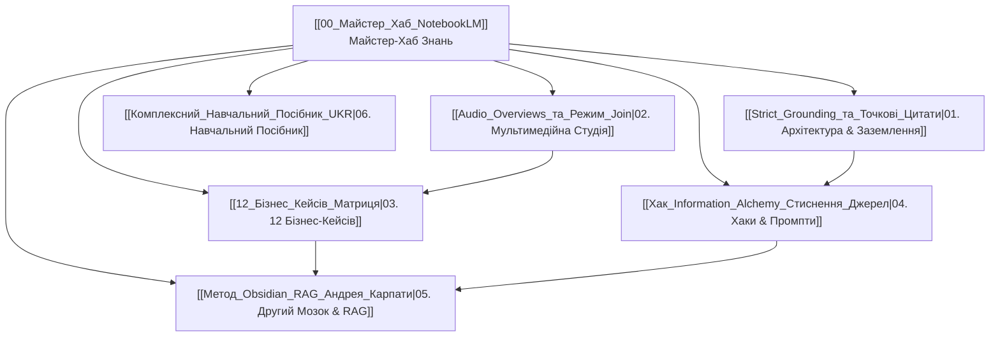

# 🧠 Майстер-Хаб: Google NotebookLM (Gemini Notebook)

> **Центральний Вузол Графа Знань Second Brain**  
> **Консолідований Блокнот:** `0a882755-acbf-468c-be37-21e40395dd50` (*"Google NotebookLM: Екосистема, Практика та Майстер-Гайд"*)  
> **База джерел:** 129 перевірених першоджерел (YouTube, Google Support, GitHub, Reddit).

---

## 🗺️ Інтерактивна Павутина Знань (Кластери)

---

## 📌 Ключові Напрямки Навігації

### 1. 🏛️ Архітектура та Заземлення
* [[Strict_Grounding_та_Точкові_Цитати]] — Принцип нульових галюцинацій та верифікації фактів.
* [[Технічні_Ліміти_та_Формати_Джерел]] — Ліміти слів, формати PDF, YouTube, Docs, MP3.
* [[Політика_Конфіденційності_Google]] — Захист даних: дані не використовуються для навчання публічних моделей.
* [[Хмарний_Компютер_та_Виконання_Коду]] — Cloud Sandbox: запуск Python-коду, математика, генерація Excel.

### 2. 🎙️ Мультимедійна Студія (Studio)
* [[Audio_Overviews_та_Режим_Join]] — Розмовні подкасти, режим прямого втручання голосом.
* [[Video_Overviews_та_Google_Vids]] — Відеопрезентації зі слайдами (Whiteboard, Watercolor, Classic).
* [[Інтерактивні_Ментальні_Карти_Mind_Maps]] — Візуальне дерево знань із фокусним викликом чату.
* [[Active_Recall_Флеш_Картки_та_Anki]] — Інтервальне повторення, картки Cloze та експорт у CSV.
* [[Studio_Інфографіка_та_Слайди]] — Дизайн інфографік, кольорові палітри та дорожні карти.

### 3. 💼 12 Практичних Бізнес-Кейсів
* [[12_Бізнес_Кейсів_Матриця]] — Повна зведена таблиця всіх 12 сценаріїв холдингу.
* [[Кейс_01_Тренажер_Відділу_Продажів]] — Онбординг менеджерів за 3 дні.
* [[Кейс_02_Корпоративний_Онбординг]] — Заміна 100 сторінок регламентів інтерактивним курсом.
* [[Кейс_03_Оцифрування_Чатів_TG_та_WhatsApp]] — Перетворення робочих переписок на базу знань.
* [[Кейс_04_Цифровий_Двійник_Керівника]] — Збереження інституційної пам'яті холдингу.
* [[Кейс_05_Офісний_Технічний_Помічник]] — Швидкий ремонт техніки без виклику майстра.
* [[Кейс_06_Аналіз_Цін_та_Маржинальності]] — Виявлення аномалій та порівняння прайсів постачальників.
* [[Кейс_07_Аналіз_Дзвінків_РОПа_та_Заперечень]] — Глибинний аудит переговорів та скриптів.
* [[Кейс_08_Глибинний_CustDev_із_CRM]] — Прогрів реальних болей клієнтів.
* [[Кейс_09_Ринкові_Дослідження_та_Стратегія]] — Deep Research для стратегічних сесій.
* [[Кейс_10_Швидка_Підготовка_до_Переговорів]] — 10-хвилинне досьє на будь-якого партнера.
* [[Кейс_11_Порівняння_Договорів_та_Актів]] — Запобігання штрафам і пошук прихованих ризиків.
* [[Кейс_12_Контент_Стратегія_та_Аналіз_Конкурентів]] — Віральний маркетинг на основі прогалин ринку.

### 4. 🔮 Просунуті Хаки та Алгоритми
* [[Хак_Information_Alchemy_Стиснення_Джерел]] — Обхід ліміту джерел через `Convert to Source`.
* [[Хак_Master_Instructions_Doc]] — Подолання ліміту довжини системного промпта.
* [[Алгоритм_Late_Chunking]] — Збереження глобального контексту між сторінками.
* [[Промпт_Фреймворки_Gap_Analysis_та_Скептик]] — Промпти Стівена Джонсона, Feynman та Devil's Advocate.
* [[Топ_Браузерних_Розширень_для_NotebookLM]] — Інструменти для захоплення YouTube та веб-сторінок.

### 5. 🤖 Другий Мозок та AI-Інтеграції
* [[Метод_Obsidian_RAG_Андрея_Карпати]] — Локальна Вікіпедія на комп'ютері.
* [[Вирішення_Проблеми_Index_Tax]] — Захист від перевитрати токенів при мільйонах слів.
* [[Трьохрівнева_Гібридна_Пам_ять]] — Obsidian + Pinecone + NotebookLM.
* [[Zero_Token_RAG_для_AI_Агентів]] — Підключення агентів холдингу через API та MCP.
* [[SDK_та_CLI_notebooklm_py]] — Автоматизація через термінал і Python.

### 6. 📝 Навчальний Посібник та Тести
* [[Комплексний_Навчальний_Посібник_UKR]] — Повний конспект знань.
* [[Словник_Термінів]] — Фундаментальні визначення.
* [[Тест_Самоперевірки_10_Запитань]] — Тестові запитання з детальними поясненнями.

---
*Створено агентом SONAR для Другого Мозку холдингу.*
